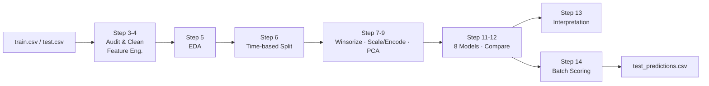

# Credit Score Classification Model
## Technical Report · Financial Analytics Framework (TDSP × Gartner Analytics Maturity)

---

### Document Control

| Field | Detail |
|---|---|
| Document Title | Credit Score Classification — Technical Report (Step 1–14) |
| Source Artifact | `credit_score_model_1.ipynb` |
| Version / Date | v1.0 · 28 พฤศจิกายน 2569 |
| Classification | Internal — Contains data-handling notes (PII fields in raw data) |
| Framework | Microsoft TDSP Lifecycle · Gartner Analytics Maturity |
| Status | Modeling & Batch Scoring completed · Acceptance pending |

### สารบัญ
1. [Executive Summary](#1-executive-summary)
2. [Business Understanding](#2-business-understanding)
3. [Solution Architecture](#3-solution-architecture)
4. [Data Acquisition & Understanding (Step 1–5)](#4-data-acquisition--understanding-step-15)
5. [Modeling (Step 6–13)](#5-modeling-step-613)
6. [Deployment (Step 14)](#6-deployment-step-14)
7. [Quality Gates & Governance](#7-quality-gates--governance)
8. [Risk Register](#8-risk-register)
9. [Roadmap](#9-roadmap)
10. [Appendix](#10-appendix)

---

## 1. Executive Summary

### KPI Scorecard

| Valid Macro F1 | Valid Accuracy | Features (Final) | Models Compared | Residual Missing |
|:---:|:---:|:---:|:---:|:---:|
| **0.6849** | **0.6950** | **35** (PCA) | **8** | **0** |

| มิติ | สรุป |
|---|---|
| **Objective** | ทำนายเครดิตสกอร์ (`Poor` / `Standard` / `Good`) ของลูกค้า 12,500 ราย สำหรับเดือน ก.ย.–ธ.ค. |
| **Approach** | ล้างข้อมูลเชิงลำดับเวลา → Lag Features → แบ่งข้อมูลตามเวลา → เปรียบเทียบ 8 โมเดล |
| **Selected Model** | Neural Network (MLP) — คัดเลือกด้วย Valid Macro F1 |
| **Key Drivers** | `Credit_Mix` · `Outstanding_Debt` (ปัจจุบัน/เดือนก่อน) · `Interest_Rate` |
| **Key Risks** | Overfitting (Train 0.87 vs Valid 0.70) · PCA อาจลดประสิทธิภาพ (RF ก่อน PCA = 0.7169) |
| **Recommendation** | ทดสอบโมเดลโดยไม่ใช้ PCA · จูนด้วย `TimeSeriesSplit` · ตั้ง Monitoring ก่อนใช้งานจริง |

---

## 2. Business Understanding

| หัวข้อ | รายละเอียด |
|---|---|
| Problem Statement | ประเมินระดับเครดิตลูกค้าล่วงหน้าเพื่อสนับสนุนการพิจารณาสินเชื่อและบริหารความเสี่ยง |
| Task Type | Multiclass Classification (3 คลาส) |
| Primary KPI | Valid **Macro F1** (คลาสไม่สมดุล: Standard 53.2% · Poor 29.0% · Good 17.8%) |
| Secondary KPI | Valid Accuracy · Train–Valid Gap · F1 รายคลาส |
| Key Constraint | Test = ลูกค้าเดิมในอนาคต → ต้องแบ่งข้อมูลตามเวลา |

### Analytics Maturity Coverage

| Gartner Level | คำถาม | ความครอบคลุม | Step |
|---|---|:---:|---|
| Descriptive | เกิดอะไรขึ้น | ● | 3, 5 |
| Diagnostic | ทำไมจึงเกิด | ● | 5, 13 |
| Predictive | จะเกิดอะไรขึ้น | ● | 6–12, 14 |
| Prescriptive | ควรทำอะไร | ○ | — |

---

## 3. Solution Architecture

### TDSP Stage Mapping

| TDSP Stage | Step | Status |
|---|---|:---:|
| Business Understanding | Section 2 | ✅ |
| Data Acquisition & Understanding | 1–5 | ✅ |
| Modeling | 6–13 | ✅ |
| Deployment | 14 | 🟡 Partial |
| Customer Acceptance | — | ⬜ Pending |

---

## 4. Data Acquisition & Understanding (Step 1–5)

### Step 1 — Environment Setup
| Objective | Method | Output |
|---|---|---|
| เตรียมสภาพแวดล้อมที่ทำซ้ำได้ | `pandas` · `numpy` · `matplotlib` · `seaborn` · `scikit-learn` · `RANDOM_STATE = 42` | ไฟล์ข้อมูลพบครบ (`True True`) |

### Step 2 — Data Ingestion
| Dataset | Shape | Customers | Months | Target |
|---|---|---:|---:|:---:|
| Train | 100,000 × 28 | 12,500 | 8 (ม.ค.–ส.ค.) | ✔ |
| Test | 50,000 × 27 | 12,500 | 4 (ก.ย.–ธ.ค.) | ✘ |

### Step 3 — Data Quality Audit
| Issue Type | Findings (Train) |
|---|---|
| Hidden placeholders | `Credit_Mix` 20,195 · `Payment_of_Min_Amount` 12,007 · `Payment_Behaviour` 7,600 · `Occupation` 7,062 |
| Malformed numerics (`_`) | `Annual_Income` 6,980 · `Age` 4,939 · `Num_of_Loan` 4,785 · `Amount_invested_monthly` 4,305 |
| True NaN | `Monthly_Inhand_Salary` 15,002 · `Type_of_Loan` 11,408 · `Credit_History_Age` 9,030 |
| Impossible values | เช่น `Age = -500` |

### Step 4 — Cleaning & Feature Engineering
| # | Process | Detail |
|:---:|---|---|
| 1 | Sanitization | Placeholder และค่านอกช่วง `VALID_RANGE` → `NaN` |
| 2 | Type conversion | ลบ `_` แล้วแปลงเป็น float |
| 3 | Feature extraction | `Credit_History_Months`, `Num_Loan_Types` |
| 4 | Longitudinal imputation | ffill → median/mode รายลูกค้า → median/mode รวม |
| 5 | Lag features | `Prev_Outstanding_Debt` · `Prev_Delay_from_due_date` · `Prev_Credit_Utilization_Ratio` |
| 6 | Column selection | ตัด `Name`, `SSN` |

- **Data Lineage:** Test ถูกล้างโดยต่อประวัติ Train (`ref_train`) เพื่อให้ Lag ของ ก.ย. อ้างอิง ส.ค.
- **Output:** Train `(100000, 30)` · Test `(50000, 29)` · Missing = **0**

### Step 5 — Exploratory Data Analysis
| Feature | Poor | Standard | Good |
|---|---:|---:|---:|
| Annual_Income | 40,623 | 51,076 | 65,252 |
| Outstanding_Debt | 2,081.5 | 1,278.4 | 801.3 |
| Interest_Rate | 20.2 | 13.8 | 7.7 |
| Delay_from_due_date | 29.7 | 19.7 | 10.9 |
| Num_Credit_Inquiries | 8.2 | 5.3 | 3.3 |
| Credit_History_Months | 170.0 | 227.8 | 284.8 |
| Credit_Utilization_Ratio | 32.0 | 32.3 | 32.7 |

> **Insight:** หนี้ ดอกเบี้ย และการชำระล่าช้า แยกกลุ่มได้ชัด · `Credit_Utilization_Ratio` แทบไม่แยกกลุ่ม

---

## 5. Modeling (Step 6–13)

### Step 6 — Time-based Split
| Set | Period | Shape | Class Mix (Standard / Poor / Good) |
|---|---|---|---|
| Train | ม.ค.–มิ.ย. | 75,000 × 25 | — |
| Valid | ก.ค.–ส.ค. | 25,000 × 25 | 51.8% / 28.9% / 19.3% |

แบ่งก่อน Step 7–9 ทั้งหมดเพื่อป้องกัน Data Leakage

### Step 7 — Outlier Treatment
| Item | Detail |
|---|---|
| Detection (IQR 1.5×) | `Amount_invested_monthly` 8.30% · `Monthly_Balance` 7.66% · `Outstanding_Debt` 5.27% · `Total_EMI_per_month` 5.02% |
| Treatment | Winsorizing ที่ P1 / P99 |
| Principle | ขอบคำนวณจาก Train เท่านั้น · ไม่ลบแถว (ค่าสูง/ต่ำจริง) |

### Step 8 — Scaling & Encoding
| Group | Technique | Rationale |
|---|---|---|
| Numeric (21) | `RobustScaler` | ทนต่อ outlier |
| `Credit_Mix` (1) | Ordinal: Bad < Standard < Good | มีลำดับ |
| `Occupation` · `Payment_Behaviour` · `Payment_of_Min_Amount` (23) | One-Hot | ไม่มีลำดับ |

**Output:** 45 ฟีเจอร์ (fit กับ Train เท่านั้น)

### Step 9 — Dimensionality Reduction
`PCA(n_components=0.98)` → **45 → 35** องค์ประกอบ (fit กับ Train เท่านั้น)

### Step 10 — Evaluation Framework
| Metric | Role |
|---|---|
| Train / Valid Accuracy | ตรวจ Overfitting |
| Valid Macro F1 | **เกณฑ์เลือกโมเดล** |
| Confusion Matrix | วิเคราะห์ความผิดพลาดรายคลาส |

### Step 11 — Model Training
| # | Model | Key Parameters | PCA |
|:---:|---|---|:---:|
| 1 | Logistic Regression | `max_iter=1000` | ✔ |
| 2 | KNN | `k=25` | ✔ |
| 3 | Naive Bayes | Gaussian | ✔ |
| 4 | Decision Tree | `max_depth=8` | ✔ |
| 5 | Random Forest | 200 trees · depth 20 · leaf 2 | ✔ |
| 6 | Neural Network (MLP) | (64,128,64) · early stopping | ✔ |
| 7 | Random Forest | 250 trees · depth 16 · balanced | ✘ |
| 8 | HistGradientBoosting | 350 iter · depth 7 · lr 0.05 · balanced | ✘ |

### Step 12 — Model Comparison
| Rank | Model | Train Acc | Valid Acc | Macro F1 | Gap |
|:---:|---|---:|---:|---:|---:|
| 1 | **Neural Network (MLP)** | 0.8689 | 0.6950 | **0.6849** | 0.174 |
| 2 | Random Forest (PCA) | 0.9617 | 0.6972 | 0.6829 | 0.265 |
| 3 | HistGradientBoosting | 0.8091 | 0.6751 | 0.6710 | 0.134 |
| 4 | Random Forest (No PCA) | 0.7930 | 0.6625 | 0.6562 | 0.131 |
| 5 | KNN (k=25) | 0.7657 | 0.6560 | 0.6331 | 0.110 |
| 6 | Decision Tree | 0.7193 | 0.6193 | 0.5871 | 0.100 |
| 7 | Logistic Regression | 0.6737 | 0.6021 | 0.5778 | 0.072 |
| 8 | Naive Bayes | 0.6616 | 0.5810 | 0.5718 | 0.081 |

*Gap = Train Acc − Valid Acc*

**Model Card — Neural Network (MLP), Valid 25,000 แถว**

| Class | Precision | Recall | F1 | Support |
|---|---:|---:|---:|---:|
| Poor | 0.67 | 0.74 | 0.71 | 7,216 |
| Standard | 0.73 | 0.69 | 0.71 | 12,960 |
| Good | 0.64 | 0.64 | 0.64 | 4,824 |
| **Macro avg** | 0.68 | 0.69 | **0.68** | 25,000 |

### Step 13 — Model Interpretation
Random Forest แยกบนข้อมูลก่อน PCA (Valid Accuracy 0.7169) — ใช้เพื่อตีความเท่านั้น

| Rank | Feature | Importance* |
|:---:|---|---:|
| 1 | `Credit_Mix` | 0.102 |
| 2 | `Prev_Outstanding_Debt` | 0.097 |
| 3 | `Outstanding_Debt` | 0.085 |
| 4 | `Interest_Rate` | 0.075 |
| 5 | `Changed_Credit_Limit` | 0.045 |
| 6 | `Credit_History_Months` | 0.045 |
| 7 | `Num_Credit_Card` | 0.043 |
| 8 | `Delay_from_due_date` | 0.042 |

*ค่าโดยประมาณจากกราฟ*

> **Insight:** Lag Feature (`Prev_Outstanding_Debt`) ติดอันดับ 2 ยืนยันคุณค่าของฟีเจอร์เชิงลำดับเวลา

---

## 6. Deployment (Step 14)

| Item | Detail |
|---|---|
| Mode | Batch Scoring — MLP บน `X_test_pca` |
| Deliverable | `test_predictions.csv` (50,000 แถว): `ID` · `Customer_ID` · `Month` · `Predicted_Credit_Score` |
| Prediction Mix | Standard 48.7% · Poor 31.6% · Good 19.8% |
| Performance Reference | Test ไม่มีเฉลย → ใช้ Valid Macro F1 ≈ 0.68 |
| Gaps | ยังไม่บันทึก Pipeline/โมเดล · ยังไม่มี Monitoring · ยังไม่มี API |

---

## 7. Quality Gates & Governance

| Control | Evidence | Status |
|---|---|:---:|
| Data completeness หลังล้าง | Missing = 0 (Train/Test) | ✅ |
| Leakage control ใน scaler / encoder / PCA / winsorize | fit เฉพาะ Train | ✅ |
| Temporal validity | แบ่ง Train/Valid ตามเดือน | ✅ |
| Reproducibility (seed) | `RANDOM_STATE = 42` | ✅ |
| PII handling | ตัด `Name`, `SSN` ใน Step 4 | ✅ |
| Imputation ก่อนแบ่งข้อมูล | Step 4 ทำก่อน Step 6 (ค่ารายลูกค้า) | 🟡 |
| Generalization | Train–Valid Gap 0.174 (MLP) | 🟡 |
| Code reproducibility | Absolute path · Step 6 มีเซลล์ซ้ำ | 🟡 |
| Model persistence & Monitoring | ไม่มีใน notebook | ⬜ |
| Business Acceptance / Sign-off | ไม่มีใน notebook | ⬜ |

✅ ผ่าน · 🟡 ผ่านบางส่วน/ควรปรับปรุง · ⬜ ยังไม่ดำเนินการ

---

## 8. Risk Register

| ID | Risk | Impact | Likelihood | Mitigation |
|:---:|---|:---:|:---:|---|
| R1 | Overfitting (RF-PCA 0.96 vs 0.70; MLP 0.87 vs 0.70) | High | High | Regularization · จำกัดความลึก · CV ตามเวลา |
| R2 | PCA ลดประสิทธิภาพ (0.6972 vs 0.7169) | Medium | Medium | ทดสอบโมเดลบนข้อมูลก่อน PCA |
| R3 | คลาส Good แยกยาก (F1 0.64) | Medium | High | ปรับ threshold · class weight |
| R4 | Data drift | Medium | Medium | Monitor F1 / PSI รายเดือน |
| R5 | Leakage จาก Imputation ข้ามช่วงเวลา | Low | Low | ตรวจซ้ำหากต้องการความเข้มงวดสูง |
| R6 | PII ในข้อมูลดิบ | Medium | Low | จำกัดสิทธิ์เข้าถึงไฟล์ต้นทาง |

---

## 9. Roadmap

| Phase | Action | Stage | Expected Outcome |
|:---:|---|---|---|
| 1 | ทดสอบ MLP / Boosting บนข้อมูลก่อน PCA | Modeling | Valid Accuracy > 0.70 |
| 2 | Tuning ด้วย `RandomizedSearchCV` + `TimeSeriesSplit` | Modeling | ลด Train–Valid Gap |
| 3 | บันทึก Pipeline + โมเดล (`joblib`) | Deployment | นำกลับมาใช้ซ้ำได้ |
| 4 | ตั้ง Monitoring (F1, PSI) | Deployment | ตรวจจับ Drift |
| 5 | Validation และ Sign-off กับผู้ใช้งานธุรกิจ | Customer Acceptance | อนุมัติใช้งานจริง |
| 6 | แนะนำปัจจัยที่ควรปรับเพื่อยกระดับเครดิต | Prescriptive | ยกระดับจาก Predictive |

---

## 10. Appendix

### A. Feature Inventory (Input 25 → Encoded 45 → PCA 35)

| Group | Count | Features |
|---|:---:|---|
| Raw numeric | 16 | Age · Annual_Income · Monthly_Inhand_Salary · Num_Bank_Accounts · Num_Credit_Card · Interest_Rate · Num_of_Loan · Delay_from_due_date · Num_of_Delayed_Payment · Changed_Credit_Limit · Num_Credit_Inquiries · Outstanding_Debt · Credit_Utilization_Ratio · Total_EMI_per_month · Amount_invested_monthly · Monthly_Balance |
| Engineered | 5 | Credit_History_Months · Num_Loan_Types · Prev_Outstanding_Debt · Prev_Delay_from_due_date · Prev_Credit_Utilization_Ratio |
| Categorical | 4 | Occupation · Credit_Mix · Payment_of_Min_Amount · Payment_Behaviour |

### B. Glossary

| Term | Definition |
|---|---|
| Macro F1 | ค่าเฉลี่ย F1 ของทุกคลาสเท่ากัน เหมาะกับคลาสไม่สมดุล |
| Winsorizing | ตัดค่าสุดโต่งให้เท่าขอบเปอร์เซ็นไทล์ โดยไม่ลบแถว |
| Lag Feature | ฟีเจอร์ที่ดึงค่าจากเดือนก่อนหน้าของลูกค้าเดียวกัน |
| Data Leakage | การใช้ข้อมูลนอกชุดฝึกในการเรียนรู้ ทำให้ผลประเมินสูงเกินจริง |
| PCA | การแปลงฟีเจอร์เป็นองค์ประกอบหลักที่ไม่สัมพันธ์กัน เพื่อลดมิติ |
| PSI | Population Stability Index ใช้วัดการเปลี่ยนแปลงของการกระจายข้อมูล |

### C. Sign-off

| Role | Name | Date | Signature |
|---|---|---|---|
| Data Scientist | | | |
| Model Reviewer | | | |
| Business Owner | | | |